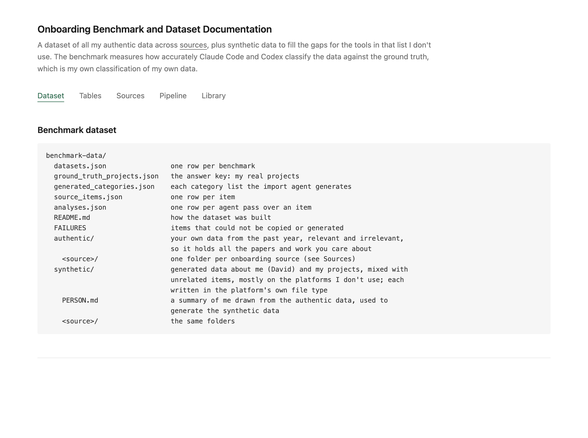

# Onboarding Benchmark

Builds a personal onboarding dataset (authentic and synthetic) and benchmarks how accurately Claude Code and Codex classify it.

**[Onboarding Benchmark and Dataset Documentation](docs/onboarding-benchmark-and-dataset-documentation.html)**: the dataset, tables, sources, pipeline and library. GitHub shows the file's source; to read it as a page, open it in a browser after cloning.

